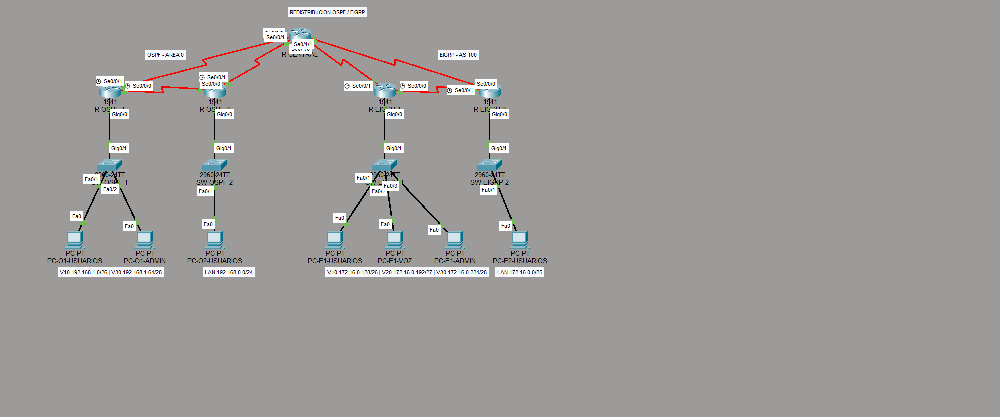

<div align="center">

# Laboratorio 3 · Algoritmos de Enrutamiento

### OSPF · EIGRP · VLSM · VLANs · Redistribución · Balanceo de carga

**Universidad del Valle de Guatemala · CC3067 Redes · Sección 10 · Grupo 1**

| Integrante | Carné |
|:--|:--:|
| Pablo Daniel Barillas Moreno | 22193 |
| Andrés Rafael Chivalán | 21534 |

</div>

---

## Estructura del repositorio

```text
Lab-3_Algoritmos-de-Enrutamiento_Version-final_Grupo-1_Redes_Sec-10/
├── Informes/
│   └── pdf/
│       ├── PDF1_VLSM_y_Conceptos.pdf
│       └── PDF2_Evidencias_Packet_Tracer.pdf
├── latex/
│   ├── figuras/
│   │   ├── evidencia_ping.png
│   │   ├── evidencia_tracert.png
│   │   └── topologia_lab3.png
│   ├── PDF1_VLSM_y_Conceptos.tex
│   ├── PDF2_Evidencias_Packet_Tracer.tex
│   └── preambulo.tex
├── packet-tracer/
│   └── Lab3_Algoritmos_Enrutamiento_Grupo1.pkt
├── .gitignore
├── LICENSE
└── README.md
```

## Archivos a revisar (por parte del auxiliar o del docente correspondiente)

| Archivo | Contenido |
|:--|:--|
| [PDF 1](Informes/pdf/PDF1_VLSM_y_Conceptos.pdf) | Cálculos VLSM, direccionamiento, sumarización y conceptos |
| [PDF 2](Informes/pdf/PDF2_Evidencias_Packet_Tracer.pdf) | Tablas de los 5 routers, ECMP, DUAL, redistribución, ping y `tracert` |
| [Proyecto Packet Tracer](packet-tracer/Lab3_Algoritmos_Enrutamiento_Grupo1.pkt) | Topología funcional y configurada |
| [Fuente PDF 1](latex/PDF1_VLSM_y_Conceptos.tex) | Documento LaTeX editable / Referencia |
| [Fuente PDF 2](latex/PDF2_Evidencias_Packet_Tracer.tex) | Documento LaTeX editable |

## Topología implementada

<p align="center">
  
</p>

```text
R-OSPF-1 -------- R-OSPF-2
    \                 /
     \               /
          R-CENTRAL
     /               \
    /                 \
R-EIGRP-1 -------- R-EIGRP-2
```

R-CENTRAL participa en OSPF área 0 y EIGRP AS 100 y es el único punto de intercambio entre dominios. R-OSPF-1 y R-EIGRP-1 implementan router-on-a-stick.

## Plan de direccionamiento

### LAN y VLAN

| Dominio | Segmento | Hosts | Red | Gateway | Capacidad útil |
|:--|:--|--:|:--|:--|--:|
| OSPF | R-OSPF-2 · usuarios | 200 | `192.168.0.0/24` | `192.168.0.1` | 254 |
| OSPF | R-OSPF-1 · VLAN 10 | 50 | `192.168.1.0/26` | `192.168.1.1` | 62 |
| OSPF | R-OSPF-1 · VLAN 30 | 10 | `192.168.1.64/28` | `192.168.1.65` | 14 |
| EIGRP | R-EIGRP-2 · usuarios | 100 | `172.16.0.0/25` | `172.16.0.1` | 126 |
| EIGRP | R-EIGRP-1 · VLAN 10 | 60 | `172.16.0.128/26` | `172.16.0.129` | 62 |
| EIGRP | R-EIGRP-1 · VLAN 20 | 30 | `172.16.0.192/27` | `172.16.0.193` | 30 |
| EIGRP | R-EIGRP-1 · VLAN 30 | 10 | `172.16.0.224/28` | `172.16.0.225` | 14 |

### Enlaces seriales

| Enlace | Subred | Extremo A | Extremo B |
|:--|:--|:--|:--|
| R-OSPF-1 ↔ R-OSPF-2 | `10.0.0.0/30` | `10.0.0.1` | `10.0.0.2` |
| R-OSPF-1 ↔ R-CENTRAL | `10.0.0.4/30` | `10.0.0.5` | `10.0.0.6` |
| R-OSPF-2 ↔ R-CENTRAL | `10.0.0.8/30` | `10.0.0.9` | `10.0.0.10` |
| R-EIGRP-1 ↔ R-EIGRP-2 | `10.0.0.12/30` | `10.0.0.13` | `10.0.0.14` |
| R-EIGRP-1 ↔ R-CENTRAL | `10.0.0.16/30` | `10.0.0.17` | `10.0.0.18` |
| R-EIGRP-2 ↔ R-CENTRAL | `10.0.0.20/30` | `10.0.0.21` | `10.0.0.22` |

## Decisiones técnicas

- La contradicción de “3 VLANs” frente a dos VLANs detalladas se resolvió implementando una tercera VLAN 30 de administración en `172.16.0.224/28`.
- OSPF anuncia dos caminos de métrica 21 hacia la LAN remota, logrando ECMP 50/50.
- EIGRP usa métricas `2,170,112` y `6,510,336`; su relación 3:1 permite un reparto aproximado 75/25 con `variance 3`.
- El resumen EIGRP hacia OSPF se implementa mediante `172.16.0.0/24` a Null0 y `redistribute static metric-type 1 subnets`, solución compatible con el IOS 1941 emulado.
- Las rutas EIGRP específicas permanecen en R-CENTRAL y vencen al resumen Null0 por coincidencia de prefijo más largo.